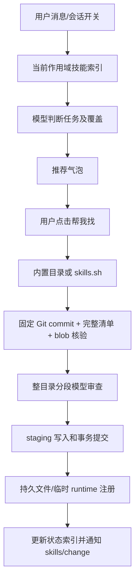

# 技能侦探开发维护交付文档

交付日期：2026-11-14（Asia/Shanghai）。项目：CyberMind-labs/dsh-skill-detective。适用对象：接手开发、测试、运维与发布的维护者。

## 1. 接手结论与版本来源

插件是 DSH 的技能发现、审查、安装和管理 bundle，包含 Host 与 Web 两部分。当前交付保留本机未发布修复，基于已联网核实的 GitHub 主干继续加固；不依赖先发布 npm。本轮没有 push、创建远端标签或发布 npm。

| 来源 | 核实结果 |
| --- | --- |
| 远端仓库 | https://github.com/CyberMind-labs/dsh-skill-detective |
| 远端 main | `28bf78c13e683f151becad64cb9465578151ce5f`，2026-11-13 16:30:54 +08:00 |
| 本地既有开发提交 | `1a1e1a1`，前一提交 `c6f8b03` 正常合并上游，保留 `fed97cf` 的发布工作流 |
| 本轮工作分支 | `improve/handoff-20261114`，在既有本地提交后继续修复；最终 SHA 用 `git log -1` 确认 |
| package.version | `1.5.0`；多个未发布提交使用同一版本，不能仅凭面板版本判断代码 |
| npm latest | 本轮联网查询为 `1.4.1` |
| GitHub 最新 Release | API 返回 `v1.0.0`（2026-11-10）；Release、Git tag、npm dist-tag 是不同发布渠道 |

GitHub 本次检查的 API：仓库、最近提交、Releases；原始摘录保存于交付工作区 `upstream-verification.json`。npm 查询地址为 https://registry.npmjs.org/dsh-skill-detective/latest 。上述结果仅代表本次交付时点。

### 三层改动必须分开看

1. **组织成员的上游改动**：`763d919`、PR #2 合并 `9d23ad1`、`28bf78c`。
2. **此前本机未发布改动**：`fed97cf`、合并 `c6f8b03`、`1a1e1a1`；从会话 ZIP 与真实 Git 工作树交叉核实。
3. **本轮新增优化**：显式审查会话、链接写入保护、远程执行位保留及本交付文档。

直接以 GitHub main 覆盖本机目录会丢失第二层修复。三份旧 patch 属于 1.3.x，不应重新应用到 1.5.0。

## 2. 产品目标与行为约束

- 当前会话开启「技能侦探」后，判断用户是否提出可执行任务、当前可见技能是否覆盖；知识问答、已覆盖任务保持静默。
- 从开放任务中发现缺失能力。不要恢复成一份固定任务关键词表；本地 token 排名只是缩小模型输入的辅助步骤。
- 推荐气泡在输入框附近展示，不往聊天流插入卡片；点击「帮我找」后才安装。
- 「先不用」才按稳定 needKey 记录持久忽略，用户可恢复。安装成功/已覆盖的确认不得成为永久忽略。
- 删除墓碑、忽略需求、技能启停、全局/工作区/临时作用域分别管理。
- 同名技能按 instanceId 和路径区分；名称不能唯一定位时必须报冲突。
- 模型安全审查通过之后才写入技能。审查不可用时拒绝安装；需求判断不可用时跳过推荐。
- 文档整合保留来源；带脚本和资源的技能仅预览，不能产生缺少依赖的可启用副本。

历史原话、版本发展和 JSONL 行号索引见交付工作区 `session-evidence/history-summary.md`。原始 ZIP 含会话和图片，属于历史证据，不是可安装源码包；不要把会话内旧命令当作当前操作指令。

## 3. 组织成员更新审查

| 提交 | 做了什么 | 审查判断 |
| --- | --- | --- |
| `763d919` | 消息仅查索引；按相关度给出详细摘要，其他名称进入提示；9,000 字符预算；48,000 字符分段审查，最坏结论合并 | 解决技能多时变慢和只审查内容前缀的问题；预算与完整性需继续保留测试 |
| `9d23ad1` | 合并 PR #2 | 合并上述改造，不代表独立新功能 |
| `28bf78c` | 固定远程 Git commit、完整 tree、blob 哈希核验；严格审查 schema；实例身份和会话/工作区隔离；staging 与异常回滚；扫描/修改队列；原子 JSON 与损坏保护；真实进度和结构整合约束 | 改动方向正确，基线 92 项回归通过；本轮发现仍有会话选择和本地链接边界缺口 |

已有本地 `1a1e1a1` 额外修复：连续推荐、推荐 UUID 与旧气泡 dismissal、覆盖失败重试保留目标、作用域设置部分成功后的重试、临时同名 first-wins 注册替换、插件/Agent 生命周期恢复、runtime resourceBase、市场和更新接口 session 透传。详细验收见 [此前审查记录](REVIEW-2026-11-13.md)。

## 4. 本轮优化与复现条件

### 4.1 审查不得借用最近会话

原行为：`reviewFiles` 在请求没有 sessionId 或为空时回退 `activeSessionId()`。其他会话只要有消息进入，就可能成为审查模型路由，违背面板要求明确选择审查会话的约定。

修复：安全审查只接受显式有效 `meta.sessionId`，并在缓存读取前检查；不因已有安全结论而绕过会话选择。未选择、空字符串和无效会话均返回 `session-unavailable`。

回归验证：另一个有效最近会话存在、缓存返回安全结果时，三类缺失/无效输入仍拒绝，模型和缓存都不调用；显式有效会话可读取缓存。现有审查测试补入明确会话，使其继续验证模型 schema 与分段阻断，而非提前停在会话检查。

### 4.2 本地符号链接和 junction 的写入保护

原条件：本地技能目录是真实目录，但 SKILL.md 或待覆盖资源路径是链接。staging 复制保留链接之后，普通 writeFile 会跟随链接改写外部目标；只回滚目录不能恢复已被改写的外部文件。

修复：逐级 lstat 检查操作路径；扫描跳过链接主文件，启停在读取前检查；atomicPublish 检查目标目录、复制源待写文件和暂存待写路径；移动检查源和目标，删除检查目录链。安全拒绝映射为 HTTP 400。普通目录中的未修改资源链接可保留，删除普通目录不会删除链接目标。

边界：这是对操作开始时存在的链接的防护，无法保证抵御外部恶意进程在检查后替换目录的 TOCTOU；也没有另建执行沙箱。把整个技能根目录通过 symlink/junction 重定向的部署会被拒绝变更，需要使用真实目录。

### 4.3 保留 Git 文本脚本执行权限

原行为：远程 tree 接受 100755，但转换成 `{path,text}` 时丢失 mode；Linux 安装后 `./scripts/run.sh` 可能 Permission denied。

修复：mode 随完整文件进入审查和安装；分段保留 mode、提示显示 mode、审查缓存哈希包含 mode。只允许 100644/100755，写入后明确 chmod 为 0644/0755，包括已有 staging 文件。拒绝 setuid 等任意模式；内置文本未指定 mode 时保持既有行为。

回归验证：mock Git tree 的 100755 经过下载解析到落盘；非法 mode 拒绝；同正文不同 mode 的缓存键不同。POSIX 权限断言由非 Windows 环境执行，本机 Windows 不能等同于已验证 Linux 执行行为。

## 5. 架构与代码导航

此仓库为原生 ESM JavaScript，无运行时 npm 依赖，无需 TypeScript 编译或 bundler 才能加载插件。建议 Node 22/24；本轮本机 Node 24.11.1。

| 文件 | 职责/修改入口 |
| --- | --- |
| `package.json` | ESM、导出、npm files 清单、DSH bundle/client 注入、测试脚本 |
| `cordis.patch.yml` | Host 插件加载声明，接入当前 profile |
| `index.js` | SkillDetective、辅助模型调用、状态/索引/缓存、扫描、检索、完整目录下载、审查、安装事务、临时注册、HTTP 路由 |
| `client.js` | React 前端，输入框开关、推荐 dock、管理页、市场、设置、更新、文档整合；内嵌样式和中英文文本 |
| `catalog.js` | 随包精选目录与技能模板；不是联网搜索的快照 |
| `prompts/skill-need.md` | actionable/coveredBy/needKey 等需求判断合约 |
| `prompts/security-audit.md` | 安全审查政策和 JSON 合约；改动会影响缓存有效性 |
| `locale/`、`icon.svg` | 宿主本地化和图标；前端内嵌文本也需同步关注 |
| `test/` | Node 原生测试，不需要 npm install 测试框架 |
| `.github/workflows/checks.yml` | Windows/Ubuntu × Node 22/24 回归配置 |
| `.github/workflows/publish.yml` | tag 版本校验、测试、打包、npm/GitHub 发布 |



重要类/函数可直接按名称搜索：`ModelJudge`、`StateStore`、`SkillIndex`、`AuditCache`、`buildNeedInput`、`planAuditChunks`、`normalizeAuditResult`、`reviewFiles`、`resolveRemote`、`mutateSkills`、`atomicPublish`、`installPrepared`、`registerTempFor`、`restoreTempRegistration`、`onUserMessage`、`apply`。

## 6. 数据目录、作用域与兼容性

`DSH_HOME` 必须在加载模块前确定，默认用户主目录下 `.dsh`。

| 数据 | 默认路径/用途 |
| --- | --- |
| 状态 | `$DSH_HOME/skill-detective.json`，安装元数据、设置、会话开关、忽略列表、删除墓碑 |
| 索引 | `$DSH_HOME/skill-detective/index.json`，v2 instanceId → 能力/路径/作用域/指纹；兼容 v1 名称键迁移 |
| 审查缓存 | `$DSH_HOME/skill-detective/audit-cache.json`，内容/路径/mode/政策/提示词哈希 → 结论 |
| 全局技能 | `$DSH_HOME/skills/<slug>/SKILL.md` |
| 工作区技能 | `<workspace>/.dsh/skills/<slug>/SKILL.md` |
| 临时技能 | `$DSH_HOME/skill-detective/temp/<sessionDirectoryId>/<slug>/SKILL.md`；目录 ID 从会话生成，不能自行假定等于原 sessionId |
| 插件自带技能 | 原插件包内，扫描可见但只读 |

全局为默认作用域。工作区技能依赖 DSH 的项目根解析，项目通常需要 `.git`；不要在插件里暗中把无效 workspace 回退默认目录。临时技能既要落盘又要在对应 Agent 注册；仅文件存在不足以证明已加载。

持久状态坏 JSON 会保留并报错，写入使用唯一临时文件替换和 `.bak`。多个同进程存储实例通过队列串行更新；不能由此推断跨 Host 进程锁已实现。集合裁剪策略在 `pruneState`；索引和状态是不同事实来源，不要任意手工覆盖其中一个。

禁用写 frontmatter `disable-model-invocation: true`。新技能名称经 ASCII slug 规范化，原名放 displayName；引用与操作使用实际实例身份。

## 7. API 与调用约定

统一前缀 `/api/dsh-skill-detective`，JSON；同时受 DSH Host 登录/访问控制与插件同源检查约束。不要使用任意端口或绕过宿主认证。客户端 `api()` 保留业务错误和成功 warnings。

| 方法/后缀 | 用途/关键参数 |
| --- | --- |
| GET `/state` | workspace/sessionId；设置、installed、索引、扫描和有效审查会话 |
| GET `/catalog`、`/market`、`/updates` | 目录、市场、版本/替代候选；市场与更新传递 sessionId |
| GET `/detail` | instanceId/path/name + workspace/sessionId |
| GET/POST `/checkbox` | 当前会话开关 |
| GET `/pending`、`/pending/latest` | 推荐待处理状态 |
| POST `/dismiss` | 带对应推荐 ID；仅明确用户忽略才抑制 |
| POST `/scan` | 显式重扫所有登记根 |
| POST `/search`、`/remote/search` | 本地检索和 skills.sh 远程查询 |
| POST `/install` | name/need、scope、workspace、显式 sessionId；冲突带 conflict 和原 instanceId/path |
| POST `/remote/install` | 远程 id=`owner/repo/skillId` 与显式会话、目标作用域 |
| POST `/toggle`、`/delete`、`/scope` | 精确实例选择；移动临时源也必须保留源会话 |
| POST `/learn`、`/learn-all` | 文档结构整合；dryRun 预览，正式整合仍需审查 |
| POST `/settings` | 默认下载作用域等设置；多条移动可能部分成功，客户端重试须跳过已提交项 |
| POST `/probe`、`/analyze` | 有效会话中的模型需求判断诊断 |
| POST `/restore-suppressed`、`/delete-record` | 恢复忽略需求/移除墓碑元数据 |
| POST `/open`、`/open-root` | 打开文件位置 |

错误重点：`session-unavailable`（会话路由）、`name-conflict`/`stale-instance`（确认目标）、`resolve-failed`（清单/下载）、`audit-unavailable`/`poison`（审查）、`unsafe-symlink`（链接路径）、`state-corrupt`（持久数据）。操作已提交后的清理问题返回 warnings，不得误报成完全失败并重复覆盖。

## 8. 无 npm 发布的本地开发、更新和回滚

本机真实链接安装源：`C:\Users\Star\Documents\deepseek-harness\default-workspace\skill-detective`。本轮审查副本：`C:\Users\Star\Documents\deepseek-harness\default-workspace\dsh-skill-detective-patches\repo`。

本机 profile：`C:\Users\Star\.dsh\profiles\desktop\package.json` 的 dependency 为 `link:C:/Users/Star/Documents/deepseek-harness/default-workspace/skill-detective`，bundles 包含 `dsh-skill-detective`。这是当前机器配置，不要把 Star 用户绝对路径提交为通用安装配置。

新维护者执行：

```powershell
git clone https://github.com/CyberMind-labs/dsh-skill-detective.git
cd dsh-skill-detective
# 若接手本交付，应使用随附 Git bundle，取到尚未推送的本地提交，见第 13 节。
node --version
npm test
node --check index.js
node --check client.js
npm pack --dry-run --json
```

在 DSH 插件管理器选择本地源码目录并启用 bundle。维护既有 link 安装时，先检查该源码目录 `git status --short`；保留用户未提交改动，在干净分支上 fetch 后 fast-forward/正常 merge，不要用复制上游目录覆盖整个工作树。更新后重载 `include:skill-detective` 对应插件并刷新现有 Web 页面。

这里 Host 和 client 均由 DSH 直接加载，本轮未改 DSH Web shell，不需要新起 Vite 服务。不要把另起服务器误认为更新了现有 GUI；也不要承诺未核实的自动热更新。

本轮更新前的源码锚点为 `1a1e1a1`。回滚采用 `git revert <本轮代码提交>`，保留后续历史，再重载插件；若仅临时排障，可在备份工作树后 checkout 原提交。不要在运行中的 Host 同时替换状态文件。数据恢复需先暂停相关变更/关闭 Host，复制当前损坏文件留证，再从 `.bak` 或更新前备份恢复，核实目录与元数据一致后重新扫描。

## 9. 测试结果、复现和边界

本轮最终测试：116 项，112 通过、0 失败、4 跳过。四项为 Windows 文件软链接 EPERM，测试显式记录跳过；三项目录 junction 测试实际通过。完整日志在交付工作区 `tests-final.log`。上游基线 92 项；保留此前本地后 107 项；本轮新增 9 项。

```powershell
npm test
node --test test/security.test.js
node --test test/symlink-safety.test.js
node --check index.js
node --check client.js
git diff --check
npm pack --dry-run --json
```

早期受限 shell 默认 Node 测试子进程报 spawn EPERM，与断言失败不同；合并 `--test-isolation=none` 跑全部文件又会共享 global fetch 桩导致干扰。若环境受限，可逐文件在独立 Node 进程用该选项执行。正式完整权限 `node --test` 已运行并以上述最终结果为准。

`security.test.js` 核验完整目录、blob、UTF-8 字节上限、分段、严格 schema、缓存、显式会话和执行位；`scope.test.js` 核验实例隔离、staging 回滚、扫描串行、临时注册和恢复；`storage-api.test.js` 核验持久状态与 HTTP；`ui-learning.test.js` 使用 React 测试夹具验证前端参数与重试，不能替代真实浏览器布局验收。

本机没有 Linux 实机执行脚本测试；权限断言在 POSIX 运行时才执行。没有重做批量真实模型准确率/恶意技能检出率评测。安全审查涉及模型误判、跨分段组合行为、后续依赖和实际权限边界，不能由回归通过推断绝对安全。

## 10. 日常维护与排障

| 症状 | 核查顺序 |
| --- | --- |
| 面板不出现 | 当前 profile 的 dependency/link、bundles、cordis 行是否启用；Host 加载错误；刷新前端 |
| 不弹推荐 | 当前会话开关、有效模型、忽略名单/墓碑、索引是否已建立、判断是否超时/已覆盖 |
| 安装提示 session-unavailable | 明确选择有效审查会话，确认对应 Agent 和模型仍在线；不要回退最近会话 |
| skills.sh 有结果但下载失败 | GitHub 元数据/commit/tree/raw/API 的状态；完整清单或哈希不符必须拒绝，不能降级只审 SKILL.md |
| Windows Git Schannel 报 SEC_E_NO_CREDENTIALS | 本次用单命令 `git -c http.sslBackend=openssl fetch origin` 成功；无需修改全局 TLS 配置或关闭证书检查 |
| 同名冲突/覆盖重试失败 | instanceId、path、作用域、workspace、sessionId 是否仍是原确认对象 |
| 临时技能显示已装但模型不可见 | 有效 session、实际 runtime 注册、first-wins 同名顺序、恢复钩子和 resourceBase |
| unsafe-symlink | 用 lstat 检查真实目录链和主文件，迁移到真实目录；不得直接取消防护 |
| state-corrupt | 保留坏文件，检查 .bak 和最新备份，暂停写入后恢复；不要静默重建空状态 |
| 强杀后隐藏 stage/backup | 未实现自动恢复，先备份目录和 JSON，人工核对哪份是原始/新内容，再决定恢复；不要批量删除隐藏备份 |

HTTP 401 的 `dsh web authentication required` 是 Host 登录控制，不是网络被墙。使用当前已认证浏览器或 Host 正式入口；不要在交付文件、日志或命令输出中记录 cookie/token。

## 11. 后续优化优先级

1. **优先：进程崩溃恢复日志**。当前异常回滚不能覆盖 rename 途中断电/强杀；设计 write-ahead transaction journal、阶段状态、幂等启动恢复，并用独立进程 kill 故障注入测试验证。
2. **优先：跨平台完整验收**。在 Ubuntu 执行 0755 权限测试，并在有文件软链接权限的环境补齐四项跳过；用实际 DSH 会话做连续推荐、覆盖失败重试、临时迁移和插件重载。
3. **维护性：拆分 index.js**。按模型、存储、远程源、文件事务、HTTP 边界逐步提取模块；先更新 package files 清单，避免拆出模块未随 npm 包发布。不要同时重写业务语义。
4. **产品待办**：全选、真实技能调用统计、拼音/模糊搜索、文件回收站。当前删除留痕只是元数据，不能恢复技能文件。
5. **评测**：建立匿名任务覆盖样本和恶意目录样本，分别测语义误报漏报、安全检出、时延和成本，避免用单元测试计数代替模型效果。

## 12. 发布与协作

本轮只完成本地开发交付，不触发远端 CI 发布。发布前先 fetch，确认组织成员新提交与 npm/tag 是否占用 1.5.0，再决定版本。tag 必须等于 `v` + package.version；本地仅显示 1.5.0 不代表 npm 已有该版本。

发布者应先跑完整测试和打包清单，确认 prompts、catalog、Host/client 等必需文件都在包里；核对发布 workflow 的 npm 凭据/受信发布配置。通过正常 PR 或团队规定方式合入，再创建正确标签。回归失败或真实验收待补时，在发布说明如实列明。

## 13. 交付文件与下一位维护者第一步

- 本文：完整的接手入口，复制给维护者即可理解项目和继续工作。
- `docs/REVIEW-2026-11-13.md`：上轮本机未发布修复的具体背景和验收。
- 交付工作区 `session-evidence/history-summary.md`：会话 ZIP 提炼与历史行号。
- 交付工作区 `tests-final.log`、`pack-manifest.json`、`upstream-verification.json`：本轮验证证据。
- 交付工作区 `dsh-skill-detective-handoff.bundle`：含完整未发布历史的 Git bundle；创建后用 `git bundle verify` 验证。

接手 bundle：

```powershell
git clone .\dsh-skill-detective-handoff.bundle dsh-skill-detective
cd dsh-skill-detective
git switch improve/handoff-20261114
git remote rename origin handoff
git remote add origin https://github.com/CyberMind-labs/dsh-skill-detective.git
git fetch origin
npm test
```

先阅读本地交付分支相对 origin/main 的差异，再接入自己的 DSH profile。不要从 npm 1.4.1 或 GitHub main 推断随附 bundle 缺失的修复已经发布。

## 14. 本机更新验收补记

本轮代码提交为 `cb8761b`；后续仅补充文档与打包清单的提交以 `git log -1` 和 `LOCAL-UPDATE.md` 为准。本机链接安装源从 `1a1e1a1` 正常 fast-forward 到本轮交付，更新前建立 `backup/before-handoff-20261114` 分支，状态/索引/缓存及 profile 配置备份于交付工作区 `runtime-backup-20261114/`。该备份含用户数据，不放入对外交付包。

在当前 GUI `http://127.0.0.1:61292` 的插件页面将技能侦探关闭再开启，随后刷新现有页面。通过已认证浏览器核查 `/state`、`/market`、`/updates` 均显示 JSON `ok: true`；技能管理 DOM 显示「已安装 22 个」。本轮没有安装、删除或覆盖真实用户技能；没有执行真实模型付费安装流程，也没有将页面生成视为全部交互验收通过。

README 的交接文档链接已配合 `package.json` 中 `docs/*.md` 打包清单，避免源码可读而安装包缺少文档。完整测试与打包清单、最终 SHA 和本机状态记录在外层 `LOCAL-UPDATE.md`。
